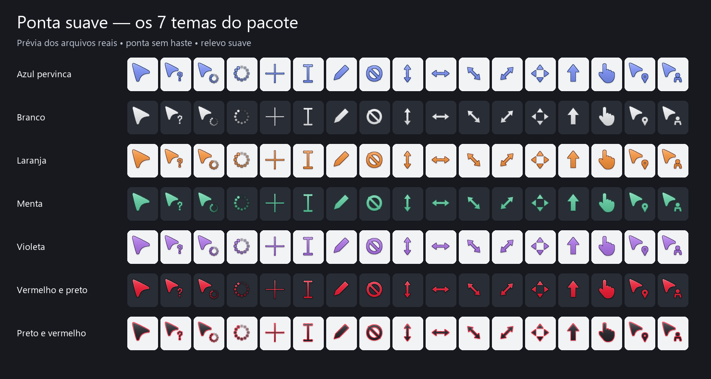

# Cool Cursor para Windows

**Versão 1.0.1 — 27/10/2026.** Pacote de cursores **Ponta suave**, com sete variações de cor, seleção visual e reaplicação automática sem console no Windows.



## Design e conteúdo

O ponteiro principal tem somente a ponta estilizada, sem haste, com cantos arredondados, borda contrastante, gradiente, reflexo e sombra discretos para sugerir volume. Os arquivos foram redesenhados em geometria paramétrica para funcionar em tamanhos pequenos; não são recortes das imagens conceituais.

| Tema | Face | Borda |
|---|---|---|
| Azul pervinca | `#8197FF` | `#243B72` |
| Branco | `#F4F5F7` | `#41454D` |
| Laranja | `#FF983E` | `#783C1F` |
| Menta | `#67D7AA` | `#215A48` |
| Violeta | `#B57AF2` | `#513174` |
| Vermelho e preto | `#F51D36` | `#151518` |
| Preto e vermelho | `#29292F` | `#F51D36` |

São **119 arquivos**, divididos em 17 estados por tema: seleção normal, ajuda, trabalho em segundo plano, ocupado, precisão, texto, escrita manual, indisponível, redimensionamento vertical, horizontal e nas duas diagonais, mover, seleção alternativa, link, localização e pessoa.

- 105 arquivos `.cur`, cada um com imagens de 32, 48, 64 e 96 pixels.
- 14 arquivos `.ani`, para espera e trabalho em segundo plano, com 12 quadros e duração nominal de 12 quadros por segundo.
- Transparência e ponto de clique definido por estado: na ponta para o ponteiro, no centro para seleção de texto, precisão e redimensionamento.
- Os símbolos funcionais, como texto e redimensionamento, preservam suas formas reconhecíveis. A restrição de não ter haste se refere ao ponteiro principal.

## Instalar e mudar a cor

1. Baixe o repositório em **Code → Download ZIP**, ou clone-o.
2. Extraia o ZIP para uma pasta local antes de executar qualquer arquivo.
3. Abra **`Escolher-tema.cmd`**.
4. Na janela **Ponta suave - Escolher cor**, selecione uma das sete cores e clique em **Aplicar cor**.

Os cursores prontos não exigem Python. O seletor usa Windows PowerShell, Windows Forms e APIs do próprio Windows. A instalação é por usuário, em `%LOCALAPPDATA%\PontaSuave`, e afeta a conta que executa o instalador.

Também é possível aplicar uma cor pelo PowerShell:

```powershell
powershell.exe -NoProfile -ExecutionPolicy Bypass -File .\Instalar.ps1 -Tema 'Vermelho e preto'
```

`ExecutionPolicy Bypass` vale apenas para o processo iniciado; o pacote não altera permanentemente a política de execução do computador. Dependendo das políticas da conta, o registro da tarefa pode ser bloqueado; nesse caso o instalador informa a falha e a persistência não deve ser presumida.

Aplicativos que desenham cursores próprios podem não acompanhar o esquema do Windows. O pacote não personaliza a tela de logon de outras contas nem a área de trabalho segura do sistema.

## Restaurar a configuração anterior

Abra **`Restaurar.cmd`**, ou use o botão **Restaurar anteriores** no seletor visual.

A restauração recupera os valores anteriores de cursores, remove a tarefa de reaplicação e devolve a preferência anterior sobre a troca de ponteiros pelos temas visuais. Os backups da primeira instalação são preservados entre as mudanças de cor; a restauração não apaga os arquivos do pacote.

Os arquivos locais `cursores-anteriores.json` e `preferencia-tema-anterior.json` são criados somente durante a instalação e não fazem parte deste repositório. Eles não devem ser compartilhados como se fossem arquivos do projeto.

## Erro identificado: retorno ao cursor padrão

### Sintoma informado

Depois de suspender o computador e retornar à sessão, o ponteiro exibido voltou ao padrão. Antes disso, o seletor iniciado por comando ou atalho também foi relatado como uma janela que abria e fechava imediatamente.

### Evidências e causa confirmada

1. A primeira verificação leu os caminhos personalizados em `HKCU\Control Panel\Cursors`, e o carregamento dos arquivos funcionou no ambiente que executava a instalação. Isso foi interpretado inicialmente como confirmação suficiente de instalação.
2. Fora desse ambiente, uma tarefa executada pelo próprio Windows verificou os mesmos caminhos e retornou **`False` para o script e para o arquivo do ponteiro**. Havia uma diferença entre a visão de arquivos do ambiente de execução e a pasta real do usuário.
3. Portanto, o registro apontava para arquivos que o Windows não encontrava em sua execução normal. A configuração escrita, isoladamente, não comprovava que os cursores estavam disponíveis ao sistema após uma nova sessão.
4. Também foi encontrado `ThemeChangesMousePointers = 1`: o tema visual podia substituir os ponteiros. O arquivo de tema ativo ainda continha os caminhos dos cursores antigos. Isso era um fator adicional de sobrescrita; não foi isoladamente comprovado como a causa do episódio específico de suspensão.
5. O esquema personalizado ainda não estava registrado como um esquema nomeado em `Control Panel\Cursors\Schemes`.

**Correção da avaliação inicial:** a verificação anterior foi insuficiente porque testou o carregamento apenas no ambiente de instalação. A checagem decisiva passou a ocorrer na sessão real do Windows, pelo Agendador de Tarefas.

### Correções aplicadas

- O pacote foi transferido para a pasta real `%LOCALAPPDATA%\PontaSuave` da conta do usuário. A transferência específica entre os ambientes foi um procedimento de implantação desta sessão, não um componente que o usuário precisa repetir ao instalar um ZIP extraído normalmente no Windows.
- O atalho **Ponta suave - Escolher cor** da Área de Trabalho foi recriado apontando para o seletor nessa pasta real. Esse atalho foi criado durante a implantação assistida; o instalador genérico deste repositório não cria automaticamente um atalho na Área de Trabalho.
- A instalação valida os arquivos selecionados com `LoadCursorFromFile` antes de alterar os valores dos cursores.
- O tema selecionado é salvo como um esquema nomeado, contendo os 17 caminhos, no registro do usuário.
- `ThemeChangesMousePointers` passa a `0`, preservando a preferência anterior em backup, para impedir que a troca de tema visual substitua os cursores.
- A escolha atual é salva em `tema-selecionado.txt`. Trocar de cor atualiza essa escolha; a reaplicação usa a última seleção, não uma cor fixa.
- A tarefa de reaplicação roda na sessão interativa do próprio usuário, sem senha armazenada e sem solicitar execução com privilégios máximos.

## Continuidade após power off, reinício e suspensão

**Com o PC desligado, nenhum programa do pacote fica em execução.** Os arquivos, o esquema, a escolha de cor e a tarefa continuam salvos no disco e na configuração do Windows. Depois que o usuário liga o computador e entra na conta, o esquema é reaplicado.

A tarefa tem três tipos de gatilho:

| Situação | Comportamento configurado |
|---|---|
| Entrada na conta, incluindo após ligar ou reiniciar o PC | Reaplica a última cor após um atraso de 5 segundos. |
| Desbloqueio da sessão | Reaplica após um atraso de 3 segundos. |
| Retorno da suspensão | Usa os eventos `Power-Troubleshooter/1` ou `Kernel-Power/107`, com atraso de 3 segundos. O gatilho de desbloqueio também cobre o retorno com desbloqueio. |

Os atrasos são os configurados, não uma garantia de prazo exato: o Agendador e a disponibilidade da sessão podem adiar a execução. Pode aparecer brevemente o cursor padrão enquanto a sessão é preparada. A aplicação na tela de bloqueio ou antes de entrar na conta não é o objetivo do pacote.

A tarefa permite execução na bateria, ignora instâncias concorrentes e tem limite de execução de um minuto. Não existe processo permanente monitorando o sistema. Os gatilhos disponíveis dependem do comportamento do Windows e do hardware; por isso o teste físico do usuário ainda é necessário.

A partir de **1.0.1**, a ação da tarefa inicia diretamente `ReaplicarSilencioso.exe`, compilado como aplicativo Windows sem console. Ele abre o PowerShell com `UseShellExecute = false` e `CreateNoWindow = true`, aguardando a conclusão e devolvendo seu código de saída. A janela não é criada para depois ser escondida. A opção `Hidden` da própria tarefa não controla janelas de processos; apenas essa opção e `-WindowStyle Hidden` na versão anterior não evitavam o lampejo na abertura do PowerShell. O seletor de cores continua visível quando aberto intencionalmente pelo usuário.

A última reaplicação grava data, resultado e nome da cor em `%LOCALAPPDATA%\PontaSuave\ultima-reaplicacao.txt`. O nome da tarefa é `PontaSuave-Persistencia-<SID do usuário>`.

### Melhoria em relação ao comportamento inicial

| Antes | Agora |
|---|---|
| Validação somente na visão de arquivos do ambiente de instalação. | Arquivos e reaplicação também verificados pelo Windows fora desse ambiente. |
| Registro podia apontar para arquivos indisponíveis na sessão normal. | Implantação na pasta real do usuário, com os 119 arquivos confirmados nessa sessão. |
| Nome do tema escrito, mas sem esquema nomeado registrado. | Esquema nomeado com 17 estados. |
| Tema visual autorizado a substituir o ponteiro. | Substituição desativada com preferência anterior preservada para restauração. |
| Nenhuma reaplicação configurada na entrada ou retomada. | Tarefa por usuário para entrada, desbloqueio e retorno da suspensão. |
| Seleção dependia do terminal. | Janela com lista de cores, botão de aplicação e mensagem de erro persistente. |

## Histórico detalhado das alterações consolidadas em 1.0.0

Esta é a primeira versão publicada. Os passos abaixo ocorreram antes do versionamento do repositório; não são versões anteriores publicadas nem commits históricos reconstruídos.

1. **Conceito visual:** criação da ponta sem haste, cantos arredondados e volume sutil; aprovação da direção visual.
2. **Paleta ampliada:** cinco cores iniciais e duas combinações adicionais, vermelho/preto e preto/vermelho.
3. **Desenho reproduzível:** implementação de geometria paramétrica, rasterização com supersampling, gradientes, reflexos, borda, sombra e transparência.
4. **Pacote funcional:** geração dos 17 estados por cor, múltiplas resoluções, pontos de clique e arquivos animados em RIFF/ACON.
5. **Instalador por usuário:** cópia para pasta local, leitura e escrita do registro e ativação pela API `SystemParametersInfo`.
6. **Correção da restauração do valor padrão:** o nome vazio do valor padrão do registro não era aceito por `New-ItemProperty`; a restauração passou a usar `RegistryKey.SetValue`, preservando também o tipo original de cada valor.
7. **Correção da atualização dos cursores:** a chamada `SPI_SETCURSORS` passou a usar os parâmetros sem flags adicionais, após a primeira tentativa de atualização ter falhado.
8. **Backup e recuperação:** cópia da configuração anterior, preservação do primeiro backup entre as trocas e tentativa de restaurar os valores se a etapa de aplicação falhar.
9. **Seletor visual:** inclusão de Windows Forms, escolha entre as sete cores e restauração; a aplicação roda em processo filho sem console, e o resultado ou erro fica visível na interface.
10. **Diagnóstico do retorno ao padrão:** identificação da diferença entre as pastas vistas pelo ambiente de instalação e pelo Windows, além da interferência permitida do tema visual.
11. **Correção da implantação:** transferência dos arquivos para o perfil real e recriação do atalho da instalação assistida, seguida de validação fora do ambiente inicial.
12. **Persistência:** esquema nomeado, bloqueio da troca de cursores pelo tema visual, arquivo de seleção e tarefa com gatilhos de entrada, desbloqueio e retomada.
13. **Correção do diretório da tarefa:** removida a dependência de um diretório de trabalho personalizado, após o erro `0x8007010B` no teste; os scripts usam caminhos absolutos e `$PSScriptRoot`.
14. **Verificação da tarefa real:** confirmação de que o Windows encontrou os 119 arquivos, execução de `Reaplicar.ps1` com registro `OK` e resultado `0` da tarefa principal. A tarefa temporária de diagnóstico foi removida.
15. **Publicação:** organização do código, artefatos, dependência de geração, exclusões de arquivos pessoais, documentação e identificação da versão inicial.

## Correção 1.0.1 — execução sem janela, 27/10/2026

**Relato:** ao retornar à sessão, uma janela de prompt aparecia rapidamente durante a reaplicação, embora os cursores permanecessem configurados.

**Causa:** a ação da tarefa iniciava um executável de console (`powershell.exe`) diretamente. A opção `-WindowStyle Hidden` era interpretada após a inicialização, permitindo a aparição momentânea do console. Marcar a tarefa como oculta não elimina esse console.

**Alterações:**

- Adicionado `ReaplicarSilencioso.cs`, com código-fonte do iniciador, e `ReaplicarSilencioso.exe`, compilado como Windows GUI (`/target:winexe`), sem janela própria.
- O processo filho usa `CreateNoWindow = true` e `UseShellExecute = false`; não depende de iniciar um console e escondê-lo depois. [Documentação da Microsoft](https://learn.microsoft.com/en-us/dotnet/api/system.diagnostics.processstartinfo.createnowindow).
- O iniciador espera a conclusão do PowerShell e retorna o mesmo código de saída, mantendo o resultado da tarefa confiável. Falhas de inicialização são gravadas em `ultima-reaplicacao.txt`, sem abrir caixas de diálogo.
- `Persistencia.ps1` passou a apontar a ação diretamente para o iniciador e valida sua presença antes de modificar a configuração de persistência.
- `Instalar.ps1` passou a copiar o executável junto ao pacote, inclusive em reinstalações e mudanças de cor.
- Adicionados `Compilar-lancador.ps1` e `verify_silencioso.py`, para compilação e testes reproduzíveis.
- Mantidos a última cor escolhida, os três gatilhos, os backups e a restauração. Não foi adicionado processo residente nem solicitação de privilégios máximos.

**Teste automatizado:** executado em uma pasta temporária com espaços no caminho, sem alterar os cursores. Confirma subsistema PE Windows GUI, erro silencioso quando o script não existe, propagação do código de saída do filho e `GetConsoleWindow() = 0` dentro do PowerShell iniciado. A validação perceptiva após o próximo retorno da sessão depende do feedback do usuário.

**Instalação real:** atualização aplicada preservando o tema vermelho e preto. A ação instalada passou a apontar para `ReaplicarSilencioso.exe`; os três gatilhos foram mantidos. A execução da tarefa principal terminou com resultado `0`, e a tarefa temporária de atualização foi removida. Não foi provocado um ciclo físico de suspensão ou reinicialização neste teste.

## Validações e feedback pendente

### Executado

- Verificação de estrutura dos 119 arquivos: 105 CUR com quatro resoluções e 14 ANI com 12 quadros.
- Checagem de offsets, dimensões, pontos de clique, cabeçalhos DIB e tamanhos RIFF.
- Carregamento dos 119 arquivos pela API nativa `LoadCursorFromFile` no ambiente inicial.
- Verificação de sintaxe dos scripts PowerShell.
- Inspeção visual da prévia gerada com os desenhos reais.
- Verificação, na sessão real do Windows, de existência de `Reaplicar.ps1`, do cursor principal e dos 119 arquivos.
- Reaplicação na sessão real com registro `OK Vermelho e preto`.
- Execução manual da tarefa permanente com **resultado `0`**, três gatilhos e ação apontando para `Reaplicar.ps1`.

### Feedback do usuário — 18/10/2026

O usuário confirmou: **“testei e funcionou”**, em retorno ao pedido de testar a continuidade da configuração após ligar ou retomar o PC. Essa é uma confirmação de funcionamento no uso real, relatada pelo usuário; não é um teste realizado pelo agente. Não foram especificados a cor nem os ciclos executados, portanto a confirmação não equivale a validar individualmente todos os cenários abaixo. Nenhuma alteração de código foi necessária após esse feedback.

### Cenários sem confirmação individual

- Desligar completamente, ligar novamente e entrar na conta.
- Reiniciar e entrar na conta.
- Suspender, retornar e desbloquear.
- Trocar a cor pelo seletor e repetir os testes com a nova cor.
- Confirmar a percepção visual e o comportamento em aplicativos e escalas de tela usados no dia a dia.

**Esses ciclos físicos não foram realizados durante a instalação assistida.** O resultado `0` comprova a execução manual da tarefa, não comprova por si só o disparo de cada gatilho em todas as situações. O feedback positivo de 18/10/2026 está registrado acima; eventuais novos problemas reproduzidos serão corrigidos e registrados em uma nova versão.

## Arquivos e responsabilidades

| Arquivo | Responsabilidade |
|---|---|
| `gerar.py` | Geometria, renderização, exportação CUR/ANI e prévia das sete cores. |
| `cores.json` | Paleta de faces e bordas dos temas fornecidos. |
| `temas/` | Os 119 cursores prontos para uso. |
| `Instalar.ps1` | Validação, backup, instalação, aplicação e restauração dos cursores. |
| `Selecionar-cor.ps1` | Interface gráfica de seleção, aplicação e restauração. |
| `Escolher-tema.cmd` | Inicialização do seletor visual. |
| `Persistencia.ps1` | Esquema nomeado, preferência de tema, seleção salva e tarefa de reaplicação. |
| `Reaplicar.ps1` | Releitura da escolha salva, aplicação sem recriar a tarefa e gravação do resultado. |
| `ReaplicarSilencioso.exe` | Entrada sem console da tarefa de reaplicação. |
| `ReaplicarSilencioso.cs` | Fonte C# do iniciador, com execução do filho sem criar console. |
| `Compilar-lancador.ps1` | Compilação do iniciador com o compilador do .NET Framework. |
| `verify_silencioso.py` | Testes isolados do iniciador e da ausência de console no filho. |
| `Restaurar.cmd` | Entrada de restauração da configuração anterior. |
| `verify.py` | Verificação estrutural dos cursores fornecidos. |
| `Previa-7-temas.png` | Prévia dos desenhos reais do pacote. |
| `LEIA-ME.txt` | Orientações resumidas junto aos arquivos. |
| `requirements.txt` | Dependência Python necessária para gerar novamente os arquivos. |
| `VERSION` | Versão publicada do pacote. |

## Gerar e personalizar

Python com Pillow é necessário somente para regenerar os cursores:

```powershell
python -m pip install -r requirements.txt
python gerar.py
python verify.py
powershell.exe -NoProfile -ExecutionPolicy Bypass -File .\Instalar.ps1 -Validar
```

Para recompilar e testar o iniciador sem console no Windows, com .NET Framework e seu compilador C# disponíveis:

```powershell
powershell.exe -NoProfile -ExecutionPolicy Bypass -File .\Compilar-lancador.ps1
python verify_silencioso.py
```

O executável já vem pronto no pacote; usuários finais não precisam compilar. As assinaturas digitais e o comportamento das políticas de segurança dependem do ambiente: o iniciador fornecido não possui assinatura digital.

Para exportar outra combinação de cores:

```powershell
python gerar.py --cor '#E51D36' --borda '#151518' --nome 'Minha cor'
```

A exportação personalizada não adiciona automaticamente a cor ao seletor: o seletor e a lista permitida do instalador cobrem as sete cores desta versão. A personalização é feita na geração dos arquivos, não por um controle de cor em tempo real do Windows. `verify.py` verifica especificamente os sete temas originais; mantenha exportações extras fora da pasta `temas/` ao rodar essa verificação.

## Versionamento

A publicação inicial consolidada usa a tag **`v1.0.0`**; a correção de execução sem console usa **`v1.0.1`**. Ajustes posteriores terão novos commits e tags, sem alterar retroativamente os resultados e limitações registrados acima. Novos relatos devem informar a cor selecionada, a situação testada e, se disponível, o conteúdo de `ultima-reaplicacao.txt`, sem compartilhar os backups pessoais.
